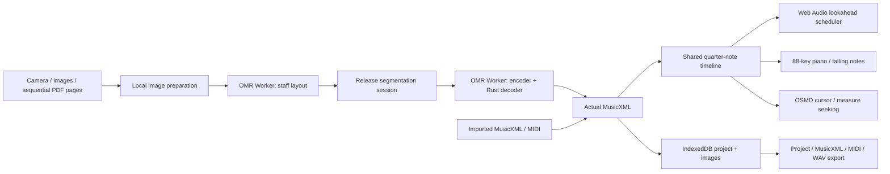

# modScore architecture

modScore is one statically hosted browser application. There is no server API, account layer, cloud database, telemetry or upload path. TypeScript and browser APIs provide the application; the heavy OMR code is reused rather than reimplemented.

## Data flow

## Modules

| Module | Responsibility |
| --- | --- |
| `src/omr.ts` | Worker request lifecycle, cancellation, image normalization, sequential PDF rendering |
| `vendor/partsong/omr-worker.js` and `omr/` | Existing homr-rs OMR pipeline and pinned ONNX Runtime Web; no app-level Partsong code |
| `src/music.ts` | Safe partwise XML parsing, explicit pitch/duration extraction, voices, chords, backup/forward, ties, pickups, tempo maps, page merge, corrections |
| `src/audio.ts` | AudioContext activation, absolute audio-clock scheduling, pause/cancel/seek, loops, metronome, voice filtering, OfflineAudioContext WAV |
| `src/instruments.ts` | GM name/program selection, pinned FluidR3 sample data, bounded caches, pitch-specific decoding |
| `src/piano.ts` | 88 key positions, pointer capture per finger, voice colors and falling notes |
| `src/sheet.ts` | Lazy local OSMD loading, score rendering and timeline cursor |
| `src/storage.ts` | IndexedDB transactions, blobs, project validation, backups, download lifecycle |
| `src/midi.ts` | MIDI parser/writer reuse; conversion to MusicXML; UTF-8 metadata handling |
| `src/i18n.ts` | English/Turkish navigation and core control translations |
| `src/main.ts` | Screens, application state and explicit user actions |
| `public/sw.js` | Same-origin shell caching, offline assets, update activation |

## Musical time and audio

All note positions and durations use quarter-note beats. Pitches are integer MIDI note numbers; XML `<pitch>/<alter>` is authoritative, so key signatures do not get accidentally applied twice. Staff clefs affect engraving, not explicit MusicXML pitches. `<backup>`, `<forward>` and `<chord>` determine polyphonic positions. Contiguous ties merge only when track, staff, voice, pitch and expected onset agree. Invalid or unsupported events generate review notices instead of fabricated notes.

Tempo conversion integrates each tempo-map segment. Playback maps this timeline to a fixed AudioContext time anchor. A 25 ms timer schedules about 120 ms ahead; the timer does not decide each note's actual start time. Seek, tempo or voice changes stop scheduled sources and establish a new anchor. Pausing stores position and cancels sources. Visibility changes, page lifecycle interruptions and nonrunning audio states pause playback to avoid large background-timer gaps.

The animation frame reads the shared audio clock, determines active events and updates keys, falling notes, notation cursor and progress. Browser output latency and display refresh impose a practical synchronization limit; no physical-device acoustic latency measurement has been performed. Audio is not timed by requestAnimationFrame. Virtual piano touches maintain separate pointer/release state so a finger lifted while decoding does not leave a stuck note.

WAV export uses the same sample scheduling function in OfflineAudioContext and a mono PCM encoder. It has an explicit 128 MiB buffer budget at 22,050 Hz, intended to prevent uncontrolled mobile allocation. This is a device-resource safeguard; longer scores can always be exported as MIDI or MusicXML.

## Recognition and resource boundaries

The application always requests the CPU path; no WebGPU is required. The generated worker forces one ONNX WASM thread. SIMD is required by the supplied artifacts. The decoder probes relaxed SIMD and falls back to the regular SIMD artifact. OMR executes inside a module Worker. Cancellation terminates that Worker. Each completed page disposes its Worker before the next page starts, trading cached-weight reload time for a lower multipage memory peak; allocations are also released before playback.

A page is processed in two steps: staff segmentation/layout, then semantic recognition with the compressed class maps. The iOS resource flag releases the segmentation ONNX session before loading the encoder. Segmentation runs one 320×320 tile at a time on CPU; staves are recognized sequentially. PDF pages rasterize one at a time and the PDF canvas is reset immediately. Browser images are orientation-corrected, capped to 2600 pixels on the long side, cropped/rotated and optionally enhanced. homr-rs performs autocrop, CLAHE and staff dewarping. Arbitrary four-corner page rectification is not yet implemented.

Model files are cached in resumable 4 MiB pieces using the existing Partsong loader, with exact expected lengths. A server that ignores Range can return a complete model. Image data is passed to the Worker as transferable buffers. Model/library hashes and upstream revisions are pinned and recorded in the build manifest. Runtime downloads do not execute downloaded SoundFont JavaScript.

The exposed reader and decoder WASM memory lengths are a lower bound on memory, not total process RSS: ONNX allocations, cached model blobs, JS, image canvases, compiled code and browser overhead are additional. The model graph peak may still exceed iOS limits on larger pages. Staff cropping is available manually; no claim of universal XS operation is made.

## Local persistence and offline operation

IndexedDB stores XML, original blobs, processed pages, review state, title and timestamps. Each write resolves on transaction completion. Recognition saves a draft and completed-page XML after every page. A resumed scan uses its recognized page count and reads remaining pages. Combining pages currently requires a consistent part count; mismatches retain the draft/per-page output and report an error.

Cache Storage holds versioned application assets, resumable model pieces and at most piano plus the current optional instrument bank. Only the active sample bank has decoded note buffers. The production service worker precaches nonmodel assets; an explicit Settings action also prepares model storage. Settings reports actual cached model completeness and storage estimates. No claim is made that persistence requests prevent eviction.

The service worker is disabled during Vite development to avoid stale imports/HMR races. Test offline behavior against a production preview. Production update identity comes from the built app hash. Updates wait until the user applies them, then replace the shell and remove old shell assets; library records are independent. The original recordings/scores are never copied into a network cache or transmitted.

## Security, licenses and deployment

Imported titles are escaped before DOM interpolation. MusicXML is parsed as XML, with a partwise root requirement, size checks, parser-error detection and rejection of entity definitions or script elements. PDF.js disables eval-supported content. Instrument downloads are parsed as a constrained data object, never evaluated. Exported filenames are normalized. There are no credentials or environment secrets.

AGPL application source, exact vendored recognition code, lockfiles, build scripts, license texts and original test notation ship in the corresponding-source archive. Weight provenance and attribution remain explicit in THIRD_PARTY_NOTICES.md. No telemetry/sharing code from Partsong is used. Optional sample requests disclose only which bank is requested, never score contents.

`dist/` is self-contained static output for a trusted HTTPS host. Models should have Range support and correct MIME types. COOP/COEP headers are provided as optional isolation support, though the selected single-thread path does not depend on SharedArrayBuffer. No production infrastructure or DNS is modified by the build.

## 0.2 review and lifecycle boundaries

`src/review.ts` owns structural encoding checks and explicit tempo/tie corrections. Structural completeness is not an OMR confidence score. `src/sheet.ts` owns auto-beaming and responsive system layout; these display choices do not rewrite the musical timeline. `src/updates.ts` owns service-worker listeners and a single update prompt, saving score data before explicit activation. See `docs/REVIEW_2026-11-22.md` for the concrete user-image finding and validation limits.

## 0.3 additions

`src/live-input.ts` owns keyboard and permission-gated MIDI messages, note release and sustain, forwarding to the existing AudioEngine/sample bank. `src/pdf-selection.ts` owns bounded PDF previews, range validation and ephemeral password dialogs. The MusicXML merger has a conservative page-track fallback for changing part/staff layouts; the renderer consumes a validated XML Document rather than letting OSMD interpret strings as URLs. Completed import pages are checkpointed in the existing IndexedDB store without a new database/schema version.

## 0.4 recognition verification and rhythm editing

The Partsong reader retains a detected grand staff with lower F, G or C clef. `omr-rs/src/barlines.rs` also restores clipped staff grids only when five real dark staff lines and light inter-line spaces are verified throughout the missing region. This prevents the grand-staff intersection from cropping away valid notation. Empty, black/noise-filled and cutaway regions are rejected. The model reads the restored region normally.

Image barline counts are review evidence only. Experiments found that automatic insertion can double-count boundaries when attention drifts, so the released reader never inserts barlines based on that heuristic. The Worker reports recovered staff regions and decoder truncation. Recognition notices are embedded in MusicXML metadata and survive merging.

Source-page association is stored in the standard `miscellaneous-field` metadata element, allowing a local canvas excerpt to show the selected note's approximate model position on the correct original. Structural review flags dense tuplets and backwards positions without treating them as proven errors. Duration edits reconstruct cursor movements, reflow their own staff/voice and raise the integer tick grid when a short value needs it. Pitch-only edits preserve rhythm. Re-recognition uses a new project ID and keeps the earlier version.

The active SIMD reader variants can be rebuilt with Rust 1.96 and the wasm32 target (`--ignore-rust-version` applies only to WASM; homr-rs’s 1.98 minimum comes from AArch64 NEON intrinsics). Use `bash vendor/partsong/scripts/build-omr.sh`; update/verify artifact hashes after an intentional reader change. `MODSCORE_BUILD_THREADS=1` additionally rebuilds optional shared-memory variants using the required nightly/build-std toolchain. Ordinary app setup uses the included binaries and needs no Rust.
