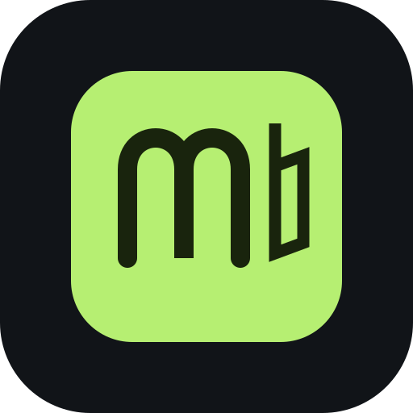
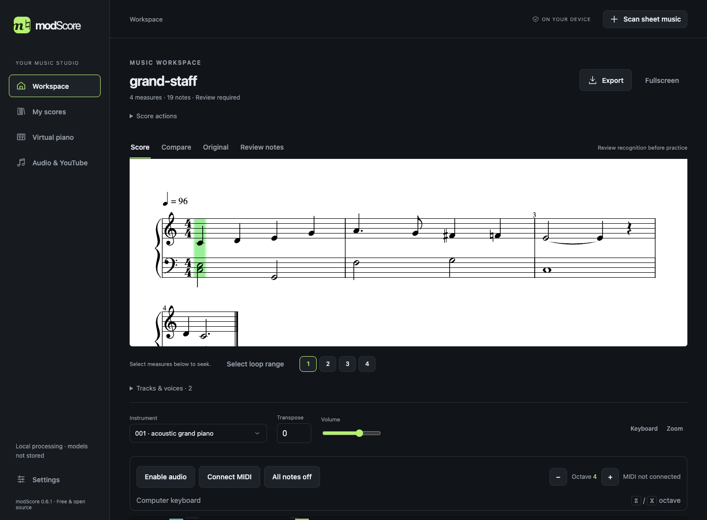
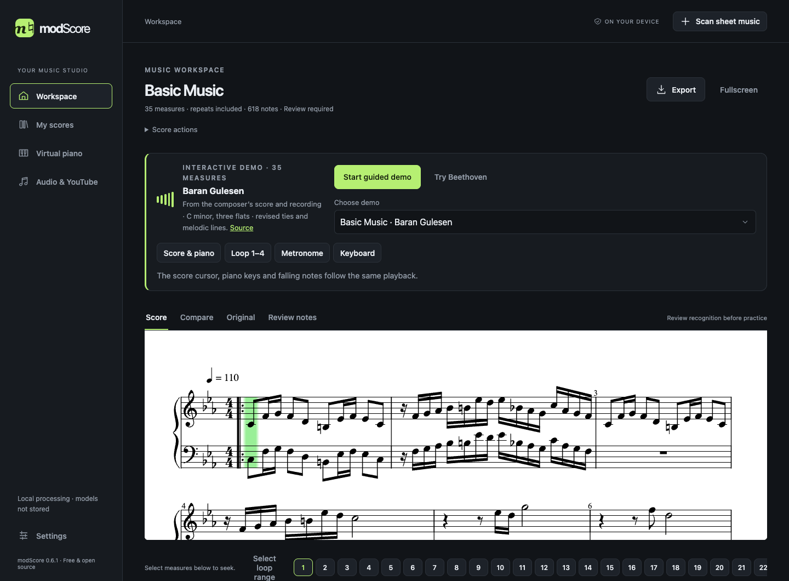

<p align="center">
  
</p>
<h1 align="center">modScore</h1>
<p align="center"><strong>SCAN. LISTEN. LEARN.</strong><br>Your music, in motion.</p>
<p align="center">
  <a href="https://wearetheartmakers.github.io/modScore/">Open the app</a> ·
  <a href="https://wearetheartmakers.github.io/modScore/about/">Website & setup guide</a> ·
  <a href="README.tr.md">Türkçe</a> ·
  <a href="https://github.com/WeAreTheArtMakers/modScore/releases">Downloads</a>
</p>
<p align="center">
  <a href="LICENSE"></a>
  
  
</p>

modScore turns printed sheet music into notation you can hear, see and practice. Import a photo or PDF, recognize the music locally, review the result and play it with a synchronized score and 88-key piano. No accounts, subscriptions, ads, analytics or score uploads.

**Working development release.** Recognition is experimental. Review pitches, rhythm, ties and parts against the original. Desktop Chrome has been tested; physical iPhone XS / iOS 18, Android, Windows, MIDI keyboards and audio interfaces still need device testing. See [limitations](docs/LIMITATIONS.md) and [recognition evidence](docs/RECOGNITION_REPORT.md).



## 0.6.1: corrected passages and source-based repertoire

Basic Music reference v3 restores held-note ties in the recurring passage and corrects adjacent-pitch draft artifacts around measures 12–14 / 26–28. Original source events, rests and clef transitions are now written directly. Earlier saved copies offer **Open corrected score** without replacing edits.

The demo chooser also offers **Bach BWV 772** (complete, 22 measures), **Bach BWV 846 Prelude** (complete, 35 measures), and **Mozart K.545 Allegro** (original opening measures 1–12). Source PDFs, attribution and source-file hashes are bundled. These are notation-source editions, not audio-model guesses. Bach ornaments/fermatas are displayed; automatic playback follows principal notes and numeric durations. See [demo sources and licenses](public/demos/LICENSE.md) and [validation](docs/REPERTOIRE_061_2026-11-23.md).

## Use it in your browser

**[Launch modScore](https://wearetheartmakers.github.io/modScore/)** — no Node.js or installation is needed for visitors. GitHub Pages serves the static app; recognition and playback run on your device.

1. Choose **Import score** for images, PDF, MusicXML or MIDI, or **Scan sheet music** for the camera.
2. For a PDF, select the pages you need. Encrypted files open with a local password prompt. Adjust image rotation, crop or contrast when necessary.
3. Choose **Recognize locally** for scanned pages. First use downloads about **158 MB of models**. Completed-page progress is saved in this browser.
4. Compare the score with **Original / Compare**, then use **Review notes** for pitch, timing, ties and tempo corrections.
5. Enable audio and play. Slow down, transpose, seek, loop measures, use the metronome or mute/solo voices.
6. Export a project backup, MusicXML, MIDI, WAV or original files. Export backups regularly; browser storage can be cleared or evicted.

The **Original test score (CC0)** is included for exploring playback. It opens reference MusicXML and is explicitly labeled; it is not presented as a recognition result.

## New in 0.6: reference notation and free practice

**Basic Music — Baran Gulesen** now follows the composer's supplied score: **C minor, three flats, 35 written measures and a played repeat at 110 BPM**. This replaces the inaccurate 0.5 automatic demo. The earlier saved copy and user edits are preserved; its banner opens the corrected edition. A 32-bar Ode to Joy piano study remains available. [Demo music rights](public/demos/LICENSE.md) are separate from the software license.

**Audio & YouTube** offers Balanced, Cleaner and Detailed detection, suggested/manual BPM and key, 4/4–3/4–6/8, a notation grid and recording start time. Optional chord suggestions add labels rather than notes. **Performance MIDI** keeps detected timing; ordinary MIDI and MusicXML follow the edited, quantized score. Automatic detection still needs review. YouTube uses the free optional local helper; local files run directly in the browser. [Audio guide](docs/AUDIO_YOUTUBE.md) · [0.6 findings and measured comparison](docs/SCORE_FIDELITY_06_2026-11-23.md).

Score and keyboard auto-positioning default off. Manual browsing releases following; enabling **Follow score** moves only the notation pane and never pulls the whole page back. Simple bounded repeats, explicit staccato/accent playback and correct signed MIDI key-signature export are supported.



## Recognition improvements in 0.4

Grand-staff recognition now preserves a piano part when the lower staff uses a treble or C clef. An image verification pass also restores clipped staff regions when all five printed lines and the spaces between them remain visible. The model then reads the recovered image area. Image-derived barline disagreements are review notices; they do not insert barlines or guess tuplets. Dense tuplet passages, backwards model positions and decoder truncation receive review notices.

In **Review notes**, open the enlarged source excerpt to inspect the selected note's approximate model location. Rhythm presets include 64th/128th notes and short triplets. Pitch-only changes preserve encoded tuplets; duration edits reflow their own voice and update MusicXML cursor movements without shifting the other staff. **Score actions → Recognize again (copy)** keeps the earlier score and makes a fresh scan with the current engine.

See the [0.4 recognition report](docs/RECOGNITION_04_2026-11-22.md) for measured improvements and remaining errors. No recognition accuracy percentage is claimed for complex repertoire.

## What you can do

| Area | Capabilities |
| --- | --- |
| Recognition | Local image/PDF OMR in a Worker; CPU WebAssembly; multiple pages; completed-page checkpoints |
| Import | Images, PDF page selection and password entry, uncompressed MusicXML, MIDI, project backups; local audio and optional YouTube helper |
| Review | Original/reconstruction comparison, note pitch/onset/duration, explicit ties, saved tempo, structural timing notices |
| Playback | Sampled instruments, tempo/speed, transpose, loops, seeking, metronome, staff/voice mute and solo |
| Virtual piano | 88 keys, touch/multitouch, computer keys, falling notes, compatible Web MIDI input |
| Instruments | 128 General MIDI choices; piano included, other banks downloaded on selection |
| Keep & share | Local IndexedDB library, project/library backup, MusicXML, MIDI, WAV and original export |
| Installation | Installable PWA with optional offline preparation, dark/light appearance, English/Turkish core UI |

Different recognized part layouts across pages are combined into page-specific tracks with a review notice. This preserves encoded notes and page order; it does not recover missed notes or infer the identity of parts between pages.

## Piano, MIDI and audio output

Open **Virtual piano**, select an instrument and choose **Enable audio**. Play using touch, the mouse or these computer keys:

```text
White keys: A S D F G H J K L ;
Black keys:  W E   T Y U   O P
Octave: Z / X
```

Typing is ignored in text fields and dialogs. Release keys to stop notes; use **Settings → All notes off** if needed.

In **Settings → Connect MIDI**, grant permission and select an input. Incoming note-on/off, velocity and sustain pedal (CC64) trigger the selected instrument. Chrome/Edge on HTTPS or localhost are the primary Web MIDI path. A connected device still needs OS drivers where applicable.

Use **Audio outputs** to choose an output when your browser supports it. Otherwise choose the sound card/audio interface in your operating system’s sound settings. MIDI input and audio output are separate connections. Physical MIDI and audio hardware have not been tested here.

## Offline and iPhone installation

1. Open the HTTPS app online. On iPhone, use Safari → **Share → Add to Home Screen** and open that icon.
2. Choose **Settings → Prepare offline use** and keep the app open until downloads finish.
3. Select any extra instrument you need before disconnecting. Only piano and the last selected bank are retained.
4. Disconnect the network and verify reopening, recognition and playback on your device.

Safari and the installed Home Screen app may have separate storage. Prepare offline use in the environment you will use. Storage persistence is a browser request, not a guarantee; keep backups outside the browser. PWA installation does not require Xcode or an Apple developer account. Physical iPhone memory/performance remains unverified.

## Run on your computer

Install **[Node.js 22.23 or newer](https://nodejs.org/en/download)**, including npm. These commands use Node on macOS, Windows or Linux; no Bash, Rust or Python is needed for the ordinary app setup. Windows/macOS include the `tar` utility used for the verified PDF package and source archive; minimal Linux installations may need to install `tar`.

**Download ZIP:** choose **Code → Download ZIP**, extract it, then open a terminal inside the extracted `modScore-main` folder. Or use Git:

```sh
git clone https://github.com/WeAreTheArtMakers/modScore.git
cd modScore
```

Then run:

```sh
npm ci
npm run setup
npm run dev
```

Open **http://localhost:5173**. Keep the terminal running; stop with **Ctrl+C**. Do not open `index.html` directly from the file manager.

`setup` downloads pinned runtime libraries and recognition models, verifies their hashes and prepares local assets. First setup requires internet and roughly 200 MB of runtime downloads plus dependencies and build space. Re-running setup reuses verified files. Runtime copies and models are intentionally excluded from Git; they are included in deployed builds. The bundled piano bank is included in the repository.

For a production build and local preview:

```sh
npm run build
npm run preview
```

Open **http://localhost:4173**. The production build enables the service worker. Localhost is treated as a secure context; a phone using an ordinary HTTP LAN address cannot use all secure-context features. Use HTTPS for device installation.

## Technologies

| Technology | Role |
| --- | --- |
| TypeScript + Vite | Application UI, strict type checking and static production build |
| Partsong / homr-rs / homr | Staff detection, perspective dewarping and optical music recognition |
| Spotify Basic Pitch (Apache-2.0) | Local audio-to-note inference and editable piano transcription |
| ONNX Runtime Web + WebAssembly | Local neural inference; one CPU WASM thread to bound memory |
| PDF.js 6.4.299 legacy | Local PDF rendering with matching Worker, polyfills, CMaps and fonts |
| OpenSheetMusicDisplay 2.2.0 / VexFlow | MusicXML engraving and playback cursor |
| Web Audio API + FluidR3 samples | Sampled instruments, scheduling, live input and local WAV rendering |
| Web MIDI API | Optional physical MIDI keyboard input |
| @tonejs/midi | MIDI import/export |
| IndexedDB + Cache Storage + Service Worker | Local library, model caching, offline app and explicit updates |
| Playwright | Browser, import, real inference, playback and offline verification |
| Node.js + fflate | Development/build tools and verified first-run asset setup |

Versions and package integrity are pinned in `package-lock.json`, [UPSTREAM.lock.json](docs/UPSTREAM.lock.json), [PDFJS.lock.json](docs/PDFJS.lock.json) and [AUDIO.lock.json](docs/AUDIO.lock.json). Ordinary use has no backend. Additional sample banks come from a pinned GitHub revision; no score data is sent with those requests.

## Deploy

The published application lives at **https://wearetheartmakers.github.io/modScore/**; its introduction and setup guide lives at **[/modScore/about/](https://wearetheartmakers.github.io/modScore/about/)**.

For GitHub Pages, `npm run build:pages` builds with the `/modScore/` base path. All app assets, workers, PDF resources, source links and offline caches resolve inside that path. For another HTTPS static host, `npm run build` defaults to `/`; set `VITE_BASE_PATH` when a different subpath is needed.

Deploy only `dist/`. The build includes models, runtime libraries, samples, PWA assets, licenses and a matching `source.tar.gz`. Node runs during the build and is not required on the web host. GitHub Pages does not process `_headers`; recognition uses the one-thread CPU path without requiring cross-origin isolation. See [deployment instructions](docs/DEPLOYMENT.md) for the publishing procedure and host requirements.

## Verify and contribute

```sh
# Terminal 1
npm run dev

# Terminal 2 (tests use installed Google Chrome)
npm test
npm run test:recognition

# Verify the production GitHub Pages subpath, no isolation headers required
npm run build:pages
node scripts/verify-pages.mjs
```

The production verification starts and stops its own temporary static server. It checks subpath imports, PDF rendering, sampled playback, PWA scope and offline reload. Set `MODSCORE_VERIFY_OMR=1` to additionally run actual image recognition in that production configuration. Full browser evidence and remaining device limitations are in [validation reports](docs/RECOGNITION_REPORT.md).

Read [CONTRIBUTING.md](CONTRIBUTING.md), [ARCHITECTURE.md](ARCHITECTURE.md) and [SECURITY.md](SECURITY.md). Report reproducible issues in [GitHub Issues](https://github.com/WeAreTheArtMakers/modScore/issues). Never attach private or copyrighted scores without permission.

## License and credits

**AGPL-3.0-only.** See [LICENSE](LICENSE). Deployed versions expose a corresponding-source download in Settings and at `source.tar.gz`. Preserve source availability, attribution and all third-party licenses when redistributing.

modScore builds on **Partsong**, **homr-rs**, **homr**, **ONNX Runtime**, **PDF.js**, **OpenSheetMusicDisplay**, **VexFlow**, **Spotify Basic Pitch**, **Tone.js MIDI** and the **FluidR3** samples by Frank Wen, converted by Benjamin Gleitzman. Sample and bundled-library licenses are separate from the application license. Model training-data provenance caveats remain documented; this project does not represent a commercial licensing clearance. Read [THIRD_PARTY_NOTICES.md](THIRD_PARTY_NOTICES.md).

Further reading: [known limitations](docs/LIMITATIONS.md) · [changelog](docs/CHANGELOG.md) · [recognition report](docs/RECOGNITION_REPORT.md) · [PDF/import review](docs/IMPORT_REVIEW_2026-11-22.md) · [multi-page and live input](docs/MULTIPAGE_LIVE_2026-11-22.md).

Build with <3 by WeAreTheArtMakers
