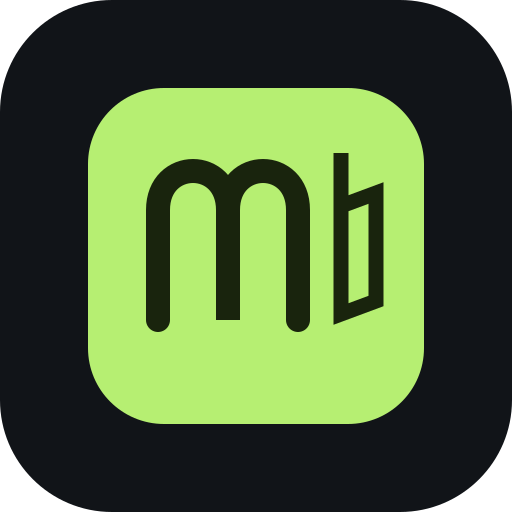
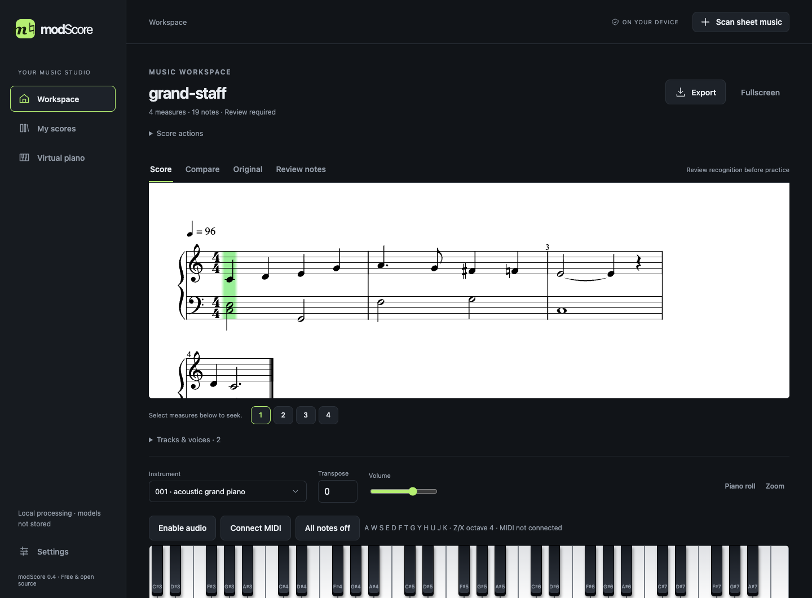

<p align="center"></p>
<h1 align="center">modScore</h1>
<p align="center">Tara. Dinle. Öğren.<br>Notaların, harekete geçsin.</p>
<p align="center"><a href="https://wearetheartmakers.github.io/modScore/">Uygulamayı aç</a> · <a href="https://wearetheartmakers.github.io/modScore/about/">Tanıtım ve kurulum</a> · <a href="README.md">English</a></p>

modScore, basılı notaları tarayıcınızda tanıyıp seslendirmenizi ve 88 tuşlu piyano üzerinde takip etmenizi sağlar. Hesap, ücretli servis, reklam veya nota yüklemesi gerekmez. Nota dosyaları cihazınızda işlenir ve tarayıcınızın yerel kitaplığında saklanır.

**Geliştirme sürümü 0.4.0.** Nota tanıma hata yapabilir; ses, ritim, bağlar ve partileri orijinalle karşılaştırın. Masaüstü Chrome testleri yapılmıştır. Gerçek iPhone XS/iOS 18, Android, Windows ve fiziksel MIDI/ses kartı testleri henüz tamamlanmamıştır.



## 0.4 ile iyileşenler

Alt portede sol veya do anahtarı bulunan piyano sistemleri artık ayrı enstrümanlara bölünmüyor. Yoğun pasajlarda kırpılmış porte bölgeleri, beş gerçek çizgi ve aralarındaki boşluklar görüntüde doğrulanırsa geri kazanılıyor; model bu alanı yeniden okuyabiliyor. Ölçü çizgisi uyuşmazlıkları inceleme uyarısıdır; otomatik çizgi eklenmez veya üçleme tahmin edilmez.

**Review notes** içinde seçili notanın yaklaşık model konumunu büyüterek inceleyebilirsiniz. 64’lük/128’lik notalar ve kısa üçlemeler için süre seçenekleri eklendi. Perde düzeltmeleri mevcut üçlemeyi korur; süre düzeltmesi diğer portenin zamanını değiştirmez. **Score actions → Recognize again (copy)** eski kaydı koruyup yeni motorla tanımaya hazırlanır.

Yoğun pasajlarda yanlış üçleme, nota ve bağ tanıma hataları hâlâ olabilir. İnceleme uyarıları doğruluk puanı değildir. [0.4 teknik raporu](docs/RECOGNITION_04_2026-11-22.md).

## Kurmadan kullanın

[Uygulamayı açın](https://wearetheartmakers.github.io/modScore/). Ziyaretçiler için Node.js gerekmez; GitHub Pages dosyaları sunar, tanıma ve ses işlemleri tarayıcıda çalışır.

1. **Import score** ile resim, PDF, MusicXML veya MIDI açın. Kamerayla çekmek için **Scan sheet music** kullanın.
2. PDF sayfalarını seçin; şifreliyse şifresini yerel pencerede girin. Gerekirse resmi kırpın, döndürün veya kontrastı ayarlayın.
3. **Recognize locally** ile tanımayı başlatın. İlk kullanımda yaklaşık 158 MB model indirilir. Tamamlanan sayfalar otomatik kaydedilir.
4. **Original / Compare** ile kontrol edin; **Review notes** bölümünde perde, zamanlama, bağ ve tempoyu düzeltin.
5. Sesi etkinleştirip çalın. Tempoyu düşürün, ölçü döngüsü kurun, transpoze edin veya partileri susturun.
6. Proje yedeği, MusicXML, MIDI, WAV veya orijinal dosyayı dışa aktarın. Tarayıcı verileri silinebildiği için yedekleri ayrıca saklayın.

Sayfalardaki parti sayıları farklıysa uygulama sayfaya özel izler oluşturup sırayla çalar ve inceleme uyarısı gösterir. Eksik tanınan notaları otomatik tamamlamaz.

## Sanal piyano, MIDI ve ses kartı

**Virtual piano → Enable audio** ile sesi açın ve enstrümanı seçin. Dokunarak, fareyle veya bilgisayar klavyesiyle çalabilirsiniz:

```text
Beyaz tuşlar: A S D F G H J K L ;
Siyah tuşlar:  W E   T Y U   O P
Oktav: Z / X
```

**Settings → Connect MIDI** bölümünde izin verip MIDI girişini seçin. Nota aç/kapat, vuruş şiddeti ve sustain pedalı (CC64) desteklenir. Chrome/Edge ve HTTPS ya da localhost kullanın. Metin alanlarında klavye notaları tetiklenmez.

**Audio outputs** ile desteklenen tarayıcılarda ses çıkışı seçilebilir. Ses kartınız listede yoksa işletim sisteminin ses çıkışından seçin. MIDI girişi ve ses çıkışı farklı bağlantılardır. Gerektiğinde **All notes off** kullanın.

## Kendi bilgisayarınızda çalıştırın

1. [Node.js 22.23 veya yenisini](https://nodejs.org/en/download) npm ile birlikte kurun.
2. GitHub’da **Code → Download ZIP** seçin ve ZIP’i açın.
3. Açılan `modScore-main` klasöründe terminal açın.
4. Şu komutları sırayla çalıştırın:

```sh
npm ci
npm run setup
npm run dev
```

Tarayıcıda **http://localhost:5173** açın. Kullanırken terminali açık bırakın; kapatmak için **Ctrl+C** kullanın. `index.html` dosyasına çift tıklayarak çalıştırmayın.

Alternatif olarak Git ile indirin:

```sh
git clone https://github.com/WeAreTheArtMakers/modScore.git
cd modScore
```

Kurulum macOS, Windows ve Linux için Node betikleri kullanır; normal kullanımda Bash, Rust ve Python gerekmez. PDF paketini ve kaynak arşivini açmak/oluşturmak için `tar` gerekir; Windows/macOS’ta bulunur, bazı Linux kurulumlarında ayrıca kurulmalıdır. İlk kurulum internet ve yaklaşık 200 MB çalışma dosyası indirir; bağımlılık ve derleme için ek disk alanı gerekir. Dosyalar hash ile doğrulanır. Windows üzerinde fiziksel doğrulama henüz yapılmadı.

Üretim sürümü hazırlamak için:

```sh
npm run build
npm run preview
```

**http://localhost:4173** adresinde üretim önizlemesi açılır. GitHub Pages için `npm run build:pages` kullanılır. Web sunucusunda Node gerekmez; `dist/` içeriği statik olarak sunulur.

## Çevrimdışı kullanım ve iPhone

- HTTPS adresini açın. iPhone’da Safari → Paylaş → Ana Ekrana Ekle seçin ve uygulamayı o simgeden açın.
- **Settings → Prepare offline use** seçip indirmelerin tamamlanmasını bekleyin.
- Kullanacağınız ek enstrümanı önceden seçin. Piyano ve en son seçilen ek banka saklanır.
- İnterneti kapatıp tekrar açma, tanıma ve çalmayı cihazınızda deneyin.

Safari ile Ana Ekran uygulaması ayrı depolama kullanabilir. Tarayıcı alanı silebilir; kütüphanenizi dışa aktararak yedekleyin. PWA kurulumu için Xcode veya Apple geliştirici hesabı gerekmez. Gerçek iPhone performansı henüz doğrulanmamıştır.

## Kullanılan teknolojiler

| Teknoloji | Görevi |
| --- | --- |
| TypeScript, Vite | Arayüz, tip kontrolü, statik derleme |
| Partsong, homr-rs, homr | Porte bulma ve optik nota tanıma |
| ONNX Runtime Web, WebAssembly | Cihaz üzerinde tek CPU iş parçacığında model çalıştırma |
| PDF.js legacy | PDF, şifreli PDF, font ve sayfa oluşturma |
| OpenSheetMusicDisplay, VexFlow | MusicXML nota gösterimi ve imleç |
| Web Audio, FluidR3 | Örneklenmiş enstrümanlar, ses planlama, WAV |
| Web MIDI, @tonejs/midi | MIDI klavye girişi, MIDI içe/dışa aktarma |
| IndexedDB, Service Worker, Cache Storage | Yerel kütüphane ve çevrimdışı kullanım |
| Playwright | Tarayıcı, gerçek tanıma, ses ve çevrimdışı testler |
| Node.js, fflate | Kurulum ve derleme araçları |

128 General MIDI enstrümanı seçilebilir; piyano dahil gelir, diğerleri ilk seçimde sabitlenmiş GitHub kaynağından indirilir. Nota içeriği gönderilmez. Çekirdek arayüz Türkçe/İngilizce; bazı teknik açıklamalar İngilizce kalabilir.

## Katkı ve lisans

[Katkı rehberi](CONTRIBUTING.md), [mimari](ARCHITECTURE.md), [dağıtım](docs/DEPLOYMENT.md), [sınırlamalar](docs/LIMITATIONS.md), [test kanıtları](docs/RECOGNITION_REPORT.md) ve [sürüm geçmişi](docs/CHANGELOG.md).

Uygulama **AGPL-3.0-only** lisanslıdır. Kaynak dağıtımı, üçüncü taraf bildirimleri ve lisanslar korunmalıdır. Örnek sesler ve diğer bağımlılıkların lisansları ayrıdır. Model eğitim verilerinin kaynağına ilişkin sınırlamalar [THIRD_PARTY_NOTICES.md](THIRD_PARTY_NOTICES.md) içinde açıklanır; ticari lisans uygunluğu garantisi verilmez.

Build with <3 by WeAreTheArtMakers
